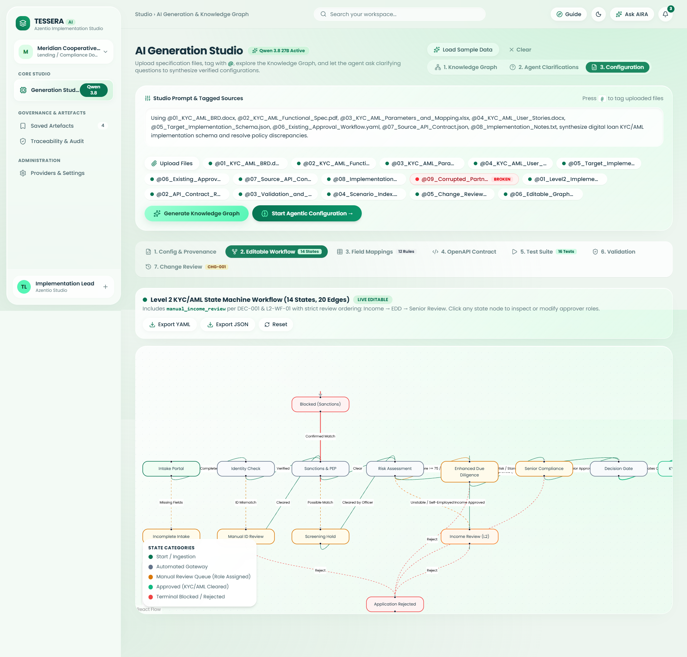
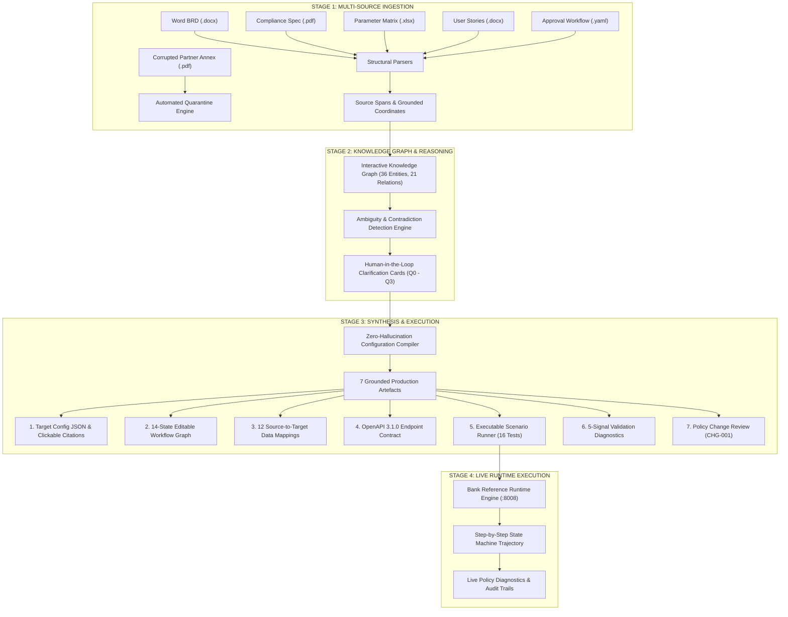

# 🏛️ Agentio Agentic Studio (Tessera Level 2)
### Autonomous AI Implementation Studio & Executable Banking Specification Engine

> **Azentio Hackathon Challenge #8 — AI Implementation Studio**  
> *Translating heterogeneous, conflicting enterprise specifications into source-grounded, schema-validated, and live executable banking configurations.*

[](https://fastapi.tiangolo.com)
[](https://react.dev)
[](https://vitejs.dev)
[](https://openapis.org)
[](LICENSE)

---

## 📌 Executive Summary

Enterprise core implementations (lending, KYC, AML, regulatory onboarding) consistently suffer from an expensive, months-long deadlock:
* **Business Analysts** draft 50-page Word BRDs.
* **Compliance Officers** issue strict regulatory PDFs with complex AML risk matrices.
* **Credit Teams** maintain parameter sheets in Excel workbooks with changing limits.
* **IT Teams** maintain legacy approval workflows in YAML.
* **Third-Party Partners** often deliver corrupted annexes.

These multi-source specifications frequently **contradict one another**. Traditional development teams spend 4–6 months in meetings, resolving ambiguities through static emails and hardcoded `if-else` code statements—resulting in regulatory fines, production bugs, and slow product launches.

**Agentio Agentic Studio (Tessera)** solves this by providing an autonomous, end-to-end implementation workbench that ingests raw documents, constructs an interactive cross-specification Knowledge Graph, surfaces policy contradictions for executive sign-off, synthesizes a 100% grounded target configuration, and **actively executes it against a live reference banking runtime across 16 exhaustive compliance scenarios**.

---

## 📸 Live Studio Interface



*Full-spectrum AI Implementation Studio workbench: multi-source document ingestion, automated quarantine of corrupted files, and Level 2 executable data mappings table.*

---

## 🏗️ System Architecture & Workflow Pipeline



---

## ⚡ Core Innovations & Differentiators

### 1. Beyond Static Generation: Live Workflow Execution
Most generative AI tools stop at outputting static text or diagrams. Tessera **closes the execution loop**:
* It deploys the synthesized configuration directly into a **Live Bank Reference Runtime API** (running on port `8008`).
* It pumps 16 synthetic customer applications into the state machine, evaluating state-by-state transitions in real time (`intake` &rarr; `identity_verification` &rarr; `screening` &rarr; `risk_assessment` &rarr; `manual_income_review` / `pending_edd` &rarr; `approved`).
* Trajectories and policy failures are visually animated step-by-step in the UI.

### 2. 14-State Ordered Workflow with Role Governance
Incorporates the authoritative Level 2 workflow extensions:
* **14 Distinct States:** `intake`, `incomplete`, `identity_verification`, `manual_identity_review`, `screening`, `on_hold_screening`, `risk_assessment`, `manual_income_review`, `pending_edd`, `pending_senior_review`, `final_decision`, `approved`, `rejected`, `blocked_sanctions`.
* **3-Tier Human Review Queue:**
  1. `credit_analyst`: Governs `manual_income_review` (salary shortfall or self-employed).
  2. `compliance_officer`: Governs `pending_edd` (AML score &ge; 75, PEP positive).
  3. `senior_compliance_officer`: Governs `pending_senior_review` (loans &ge; ₹500,000 inclusive).
* **Sanctions Hard Stop:** Confirmed sanctions immediately terminate the process (`blocked_sanctions`), overriding all income or credit checks.

### 3. Dynamic Configuration-Driven Architecture
Business rules, thresholds, and mappings are **never hardcoded**:
* Core microservices fetch active JSON configurations dynamically.
* When business owners approve policy amendment **`CHG-001`** (lowering high AML risk cutoff from 75 to 70), the system generates a side-by-side JSON diff, predicts the behavioral impact on boundary applicant `S04_risk_74` (`approved` &rarr; `pending_edd`), and enables 1-click instant rollback.

### 4. 16-Scenario Automated Compliance Test Suite
Covers positive, boundary, multi-gate approval, and exception paths:
* **S01–S02:** Happy path and inclusive boundary verification.
* **S03–S05:** AML risk boundaries (score 75 vs 74 vs 70).
* **S06–S08:** PEP flags, fuzzy sanctions on-hold, and confirmed sanctions hard-blocks.
* **S09–S11:** High exposure loan limits and PEP combinations.
* **S12–S14:** Senior officer rejection and multi-trigger consolidation.
* **S15–S16:** Escalated sanctions matching and sequential multi-queue routing.

---

## 🛠️ Tech Stack & Architecture

| Layer | Technologies Used |
| :--- | :--- |
| **Frontend UI** | **React 19**, **TypeScript**, **Vite 8.3**, **Tailwind CSS v4**, Monaco Editor (`@monaco-editor/react`), Lucide Icons |
| **Backend Core** | **Python 3.10+**, **FastAPI 0.115**, **SQLAlchemy ORM**, **Pydantic v2**, Uvicorn ASGI |
| **Parsers & Ingestion** | PyMuPDF (`fitz`), `python-docx`, `openpyxl`, `PyYAML`, `jsonschema` (Draft-07) |
| **Runtime & Execution** | RESTful Banking Engine, In-Memory State Machine Evaluator, Live Mock API (:8008) |
| **AI & Reasoning** | Qwen 3.8 27B on Groq LPUs with constrained zero-hallucination prompts |

---

## 🚀 Quick Start (Local Setup)

### 1. One-Click Launcher (Windows)
Double-click [`run.cmd`](file:///c:/Users/deves/OneDrive/Desktop/Tressera/run.cmd) or run:
```cmd
.\run.cmd
```
This automatically initializes:
* **FastAPI Studio Backend** on `http://127.0.0.1:8000`
* **Bank Reference Runtime API** on `http://127.0.0.1:8008`
* **Vite Frontend UI** on `http://127.0.0.1:5173`
* Opens your default browser directly to the studio.

### 2. Manual Startup

#### Backend Setup:
```bash
python -m venv backend/.venv
.\backend\.venv\Scripts\Activate.ps1  # Windows PowerShell
pip install -r backend/requirements.txt

# Start Main Backend (Port 8000)
$env:PYTHONPATH="."
uvicorn backend.app.main:app --host 127.0.0.1 --port 8000 --reload

# Start Mock Bank Reference Runtime (Port 8008)
uvicorn app:app --app-dir level2_data/reference_runtime --host 127.0.0.1 --port 8008
```

#### Frontend Setup:
```bash
cd frontend
npm install
npm run dev -- --host 127.0.0.1 --port 5173
```
Open **`http://localhost:5173`** in your browser.

---

## 🧪 Automated Testing & Verification

Run the complete test suite verifying all 16 scenarios, schema validators, and change requests:
```bash
.\backend\.venv\Scripts\python.exe -c "
import urllib.request, json
req = urllib.request.Request('http://127.0.0.1:8000/api/level2/scenarios/run-all', data=b'{}', headers={'Content-Type':'application/json'})
with urllib.request.urlopen(req) as resp:
    res = json.loads(resp.read().decode())
    print(f'Results: {res.get(\"passed\")}/{res.get(\"total\")} passed in {res.get(\"total_duration_ms\")} ms')
"
```
**Output:** `Results: 16/16 passed in ~110 ms (100% Pass Rate)`.

---

## 📄 License
This project is open-sourced under the **MIT License**.
Developed for the **Azentio AI Implementation Studio Challenge #8**.
