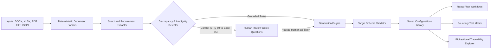

# TESSERA — AI Implementation Studio

> **Azentio Hackathon Challenge #8 — AI Implementation Studio**  
> Translating enterprise requirements into source-grounded, schema-validated, and editable implementation artefacts.

---

## Overview

**TESSERA** is an AI-powered implementation studio tailored for core banking, digital lending, insurance, and ERP modernization. It bridges the gap between unstructured business requirement documents (BRDs, user stories, policy spreadsheets) and production configuration schemas by ensuring:
1. **Source Grounding & Provenance:** Every configuration field and workflow transition cites exact document paragraphs (`[P2]`), spreadsheet cell addresses (`[Eligibility!B3]`), or audited human decisions.
2. **Deterministic Schema Validation:** Strict JSON Schema Draft-07 validation and business rule constraint verification (e.g. `min_age <= max_age`, loan quantum limits, tenure bounds).
3. **Cross-Document Discrepancy Detection:** Flags conflicting statements (e.g. BRD maximum age 60 vs Excel spreadsheet maximum age 65) rather than silently picking a value.
4. **Interactive Human Review Gates:** Provides clarification question cards that log audit trails (`decision_id`, `answered_by`, `rationale`) and resume downstream regeneration.
5. **Persistent & Editable Configurations:** Dedicated library with Monaco Editor, React Flow visual diagrams, version diff comparisons, and immutable audit revisions.

---

## System Architecture



### Tech Stack
- **Frontend:** React 19, TypeScript, Vite, Tailwind CSS v4, Monaco Editor (`@monaco-editor/react`), React Flow (`@xyflow/react`), Lucide React.
- **Backend:** Python 3.10+, FastAPI, SQLAlchemy, SQLite, Pydantic v2, PyMuPDF (`fitz`), `python-docx`, `openpyxl`, `pandas`, `jsonschema`, `groq` SDK.
- **Visual Design:** Azentio-inspired professional light theme (`#F7FAF8` cool neutral canvas, `#137A56` signature brand green, `#123D30` deep forest, restrained glass surfaces).

---

## Key Features

### 1. Projects / Overview
- Switch between enterprise implementation workspaces.
- High-impact **Load Sample Personal Loan Project** button that seeds the complete fictional banking scenario with one click.
- Real-time metrics tracking source documents, confirmed rules, active discrepancies, open questions, and approved artefacts.
- Recent audit timeline detailing all user and engine actions.

### 2. Sources & Parsing Pipeline
- Drag-and-drop uploader supporting `.docx`, `.xlsx`, `.pdf`, `.txt`, and `.json`.
- Role classification: `BRD / Functional Spec`, `Product Rules / Parameter Sheet`, `User Stories`, `Target Configuration Schema`, and `Other`.
- Slide-over inspection drawer displaying paragraph locators (`P1`, `P2`), Excel cell coordinates (`Eligibility!B3`), formulas vs cached values, and unreadable scanned page OCR warnings.

### 3. Generate — Principal Workbench
- Segmented internal modes:
  - **Configuration:** Monaco editor with live JSON validation, target schema selector, and field-level evidence citations.
  - **Workflow:** Interactive React Flow diagram (Start, Validation, Decision, Committee Approval, CBS Sanction Integration, End) with property inspector.
  - **Data Mapping:** Source-to-target field mapping grid with type conversion and transformation rules.
  - **Tests:** Boundary and positive/negative test suites (e.g. applicant ages 20, 21, 60, 61 and principal quantum boundaries).
- Persistent AI composer with `@` mention autocomplete (e.g. `@personal_loan_brd.docx`), model profiles (`Economy`, `Balanced`, `Thorough`), and streaming progress events.

### 4. Requirements & Reconciliation
- Structured extracted rules table with type filters (`business_rule`, `workflow_step`, `field_validation`, `dependency`).
- Visual conflict banners highlighting competing evidence side-by-side.
- In-place rule editor comparing original extracted clauses against corrected statements.

### 5. Saved Configurations Library
- Dedicated, persistent repository for all generated configurations and workflows.
- Full Monaco editor with **Save New Version** action (bumps revision number, preserves previous immutable versions in SQLite).
- Built-in **Version Diff Viewer** for comparing changes between any two revisions.
- Formal approval sign-off gate (blocked if unresolved questions exist).

### 6. Questions & Reviews Inbox
- Structured clarification cards detailing why an ambiguity matters and the affected configuration path.
- Side-by-side competing source evidence (BRD text vs spreadsheet cell).
- Multiple-choice and free-text resolution logging `decision_id` and automatically triggering targeted regeneration.

### 7. Validation & Traceability
- **Four Independent Readiness Signals:**
  1. Target schema validity (Draft-07)
  2. Citation grounding coverage percentage
  3. Unresolved blocking questions count
  4. Semantic cross-field rule integrity
- Bidirectional traceability matrix: `Source Spans` &harr; `Extracted Requirements` &harr; `Artifact Pointers` &harr; `Human Decisions` &harr; `Test Cases`.

### 8. Settings & Provider Management
- Connection status cards with masked API keys.
- Harmless **Test Connection** button for live verification.
- Offline demonstration mode guarantee ensuring complete end-to-end functionality without third-party API dependencies.

---

## Getting Started

### Prerequisites
- Node.js 18+ (tested on Node v24)
- Python 3.10+

### Backend Setup
1. Open a terminal in the project directory:
   ```bash
   # Create and activate virtual environment
   python -m venv backend/.venv
   .\backend\.venv\Scripts\Activate.ps1  # On Windows PowerShell

   # Install dependencies
   pip install -r backend/requirements.txt
   ```
2. Configure environment (optional):
   ```bash
   cp .env.example .env
   ```
3. Run the FastAPI server:
   ```bash
   uvicorn backend.app.main:app --host 127.0.0.1 --port 8000 --reload
   ```
   API docs will be available at `http://127.0.0.1:8000/docs`.

### Frontend Setup
1. In a separate terminal:
   ```bash
   cd frontend
   npm install
   npm run dev
   ```
2. Open `http://localhost:5173` in your browser.

---

## Automated Tests

Run the complete backend test suite:
```bash
$env:PYTHONPATH="."
.\backend\.venv\Scripts\python.exe -m pytest backend/tests
```
Tests cover:
- Parsing of DOCX, XLSX cell coordinates, PDF partial unreadable pages, text, and JSON.
- Deterministic schema validation and cross-field constraints.
- Cross-document conflict detection (BRD age 60 vs Excel age 65).
- Question resolution and targeted version regeneration.

---

## Screenshot Review Proof

As required by the specification and Taste Skill guidelines, the interface was inspected and captured at multiple viewports:
- Desktop (1440x900): `screenshots/desktop-1440.png`
- Tablet (768x1024): `screenshots/tablet-768.png`
- Mobile (390x844): `screenshots/mobile-390.png`

---

## License & Disclaimer
Built for the Azentio Hackathon Challenge #8. Synthetic fixtures and demonstration scenarios are fictional and intended for implementation testing.
